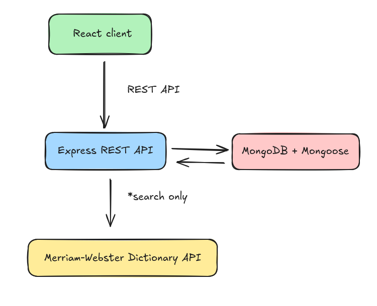

# language-power-backend

Legacy Express/MongoDB backend for the first version of the Language Power application: a vocabulary trainer that looks words up in the Merriam-Webster Collegiate Dictionary, saves them as word cards for each user, and generates practice games from those cards.

This repository is preserved as a historical project. The server still runs and the automated tests pass on the pinned toolchain, but dependencies are intentionally frozen and will not be upgraded.

## Related project

Frontend repository: [language-power](https://github.com/marusyaganza/language-power)

## Stack

- Node.js 13 (CommonJS)
- Express 4 with `express-validator` for request validation and `helmet` for security headers
- MongoDB (local via Docker, or Atlas) / Mongoose 5
- JWT authentication (`jsonwebtoken`) with `bcryptjs` password hashing
- Axios for calls to the Merriam-Webster API
- Sentry for error reporting
- PM2 as the production process manager
- Jest and ESLint

## Architecture



## Status

- Runs on the pinned toolchain
- Automated tests pass
- Dependency tree intentionally not updated
- Kept for portfolio and reference purposes

## Requirements

This project is tested with Volta-managed tool versions, pinned in the `volta` field of `package.json`:

- Node.js: `13.14.0`
- Yarn: `1.22.0`

Without Volta, install these exact versions another way (for example with nvm). Node 13.14.0 is the version the original CI used.

It also requires:

- A MongoDB database, either:
  - **local**, with [Docker](https://docs.docker.com/get-docker/) and the included `docker-compose.yml` (MongoDB 5.0), or
  - a **MongoDB Atlas** cluster.
- _(Optional)_ A [Merriam-Webster Collegiate Dictionary API](https://dictionaryapi.com) key. It is only needed for `/api/words/search`; everything else, including `/api/words/mocksearch`, works without it.

## Setup

1. Install [Volta](https://volta.sh/). Inside the project folder it switches to the pinned Node and Yarn versions automatically.
2. Install dependencies from the lockfile:

   ```bash
   yarn install --frozen-lockfile
   ```

3. Create a `.env` file from the example:

   ```bash
   cp .env.example .env
   ```

   The defaults already point at the local Docker database (`MONGO_URI=mongodb://localhost:27017/language-power?replicaSet=rs0`). Add your `MW_KEY` if you want real dictionary search.

4. Start MongoDB locally:

   ```bash
   docker compose up -d
   ```

   The container runs as a one-member replica set (`rs0`), because adding, editing and deleting cards use MongoDB transactions. Wait until `docker compose ps` shows it as `healthy`.

   **Using Atlas instead?** In `.env`, comment out `MONGO_URI` and uncomment `DB_USER`, `DB_KEY`, `DB_URL` and `DB_NAME`. `DB_URL` must start with `@`, for example `@cluster0.xxxxx.mongodb.net`. Make sure the cluster accepts connections from your IP address.

5. Add the game catalog to the database:

   ```bash
   yarn seed
   ```

   This adds the four games this backend supports (`audio`, `wordDefinition`, `definitionWord`, `writing`) with their logos. Games that already exist are updated to match, so it is safe to run again. Without this step `/api/games/catalog` returns an empty list.

6. Start the development server:

   ```bash
   yarn dev
   ```

   The API is now available at `http://localhost:3000` (or the `PORT` from `.env`). A quick check that it is up:

   ```bash
   curl http://localhost:3000/api/games/catalog
   ```

The server only starts listening on `PORT` after it has connected to MongoDB. If the connection fails, the error is printed to the console and the process exits without serving requests.

To stop the local database, run `docker compose down`. The compose file defines no volume, so the data is removed along with the container.

## Environment variables

Variables are loaded from `.env` with `dotenv`. See `.env.example` for a template.

| Variable          | Required          | Description                                                                                                                                 |
| ----------------- | ----------------- | ------------------------------------------------------------------------------------------------------------------------------------------- |
| `MONGO_URI`       | Yes, or `DB_*`    | Full MongoDB connection string, e.g. `mongodb://localhost:27017/language-power?replicaSet=rs0`. When set, the `DB_*` variables are ignored. |
| `DB_USER`         | Atlas only        | MongoDB Atlas user name                                                                                                                     |
| `DB_KEY`          | Atlas only        | MongoDB Atlas password                                                                                                                      |
| `DB_URL`          | Atlas only        | Cluster host, **starting with `@`**, e.g. `@cluster0.xxxxx.mongodb.net`. It is appended directly after `DB_KEY`.                            |
| `DB_NAME`         | Atlas only        | Database name                                                                                                                               |
| `PORT`            | Yes               | Server port. If unset, Node picks a random free port.                                                                                       |
| `TOKEN_KEY`       | Yes               | Secret used to sign and verify JWTs                                                                                                         |
| `SEARCH_ENDPOINT` | Yes, for search   | Merriam-Webster API base URL, e.g. `https://www.dictionaryapi.com/api/v3/references/collegiate/json`                                        |
| `MW_KEY`          | Yes, for search   | Merriam-Webster API key. Not needed for `/api/words/mocksearch`.                                                                            |
| `AUDIO_ENDPOINT`  | Yes, for search   | Base URL for pronunciation audio, e.g. `https://media.merriam-webster.com/soundc11`                                                         |
| `FE_ORIGIN`       | Yes, for browsers | Frontend origin sent in the `Access-Control-Allow-Origin` header                                                                            |
| `SALT_NUMBER`     | Yes, for signup   | bcrypt salt rounds, e.g. `12`                                                                                                               |
| `mode`            | No                | Set to `dev` to enable signup and log errors to the console. Any other value disables signup.                                               |
| `SENTRY_DSN`      | No                | Sentry DSN. Error reporting is off when unset.                                                                                              |
| `NODE_ENV`        | No                | Set by PM2 from `ecosystem.config.js` (`production` for `yarn start`). The application code does not read it.                               |

## Scripts

| Script                               | Description                                                                                                                             |
| ------------------------------------ | --------------------------------------------------------------------------------------------------------------------------------------- |
| `yarn dev`                           | Start the app with nodemon, restarting on file changes                                                                                  |
| `yarn start`                         | Start production process with PM2 runtime, one worker per CPU core (`ecosystem.config.js`)                                              |
| `yarn seed`                          | Add the game catalog to the database, updating games that already exist (`scripts/seed-games.js`)                                       |
| `yarn test`                          | Run test suite                                                                                                                          |
| `yarn test:watch`                    | Run tests in watch mode                                                                                                                 |
| `yarn coverage`                      | Run tests with coverage and enforce the thresholds in `jest.config.js`                                                                  |
| `yarn lint`                          | Run ESLint                                                                                                                              |
| `yarn format-fix`                    | Apply ESLint fixes                                                                                                                      |
| `yarn ready`                         | Apply ESLint fixes, then run tests with coverage                                                                                        |
| `yarn analyze`, `yarn analyze:login` | Profile the server with [Clinic.js](https://clinicjs.org/) Doctor. Clinic is not a project dependency and must be installed separately. |

## API overview

All responses are JSON. Errors are returned as a JSON string with the matching HTTP status code. Protected routes expect an `Authorization: Bearer <token>` header with a token from `/login` or `/signup`. Static images used by the games are served from `/uploads/images`.

### Auth routes `/api/user`

- `GET /` — list all users, without passwords
- `POST /signup` — create a new user and return a token; disabled unless `mode=dev` (returns 503)
- `POST /login` — authenticate a user and return a token

### Word routes `/api/words`

- `GET /search/:query` — search the Merriam-Webster Collegiate Dictionary and return formatted entries
- `GET /mocksearch/:query` — offline search against saved responses; works only for `shoal`, `ball`, `court`, `demure`, `doll`, `hit`, `rubber` and `wot`
- `GET /card/:cardId` — get a single card
- `GET /` — get all cards for the current user
- `POST /addCard` — add a new card (requires `name`, `uuid` and a non-empty `defs` array)
- `PATCH /edit/:cardId` — update a card
- `DELETE /:cardId` — delete a card

Authentication required for `GET /`, `POST /addCard`, `PATCH /edit/:cardId` and `DELETE /:cardId`.

### Game routes `/api/games`

- `GET /catalog` — get available games (filled by `yarn seed`). Each game's `logo` (JPEG) and `logoW` (WebP) are paths relative to the server, e.g. `uploads/images/audio.jpg` and `uploads/images/audio.webp`
- `POST /catalog` — add a game to the catalog
- `GET /:gameId` — get game data built from the current user's cards, where `gameId` is the game's `name`
- `PATCH /score` — save game results (requires `userId`, `gameId` and a `gameResults` array)

Authentication required for `GET /:gameId` and `PATCH /score`.

## Legacy note

This repository reflects an earlier stage of the project and is intentionally preserved with its original architecture and dependency choices. Node.js 13 and several dependencies are long past end of life, so it is not suitable for public deployment as is. It is not maintained as a modern production starter, but it remains runnable as documented above.
